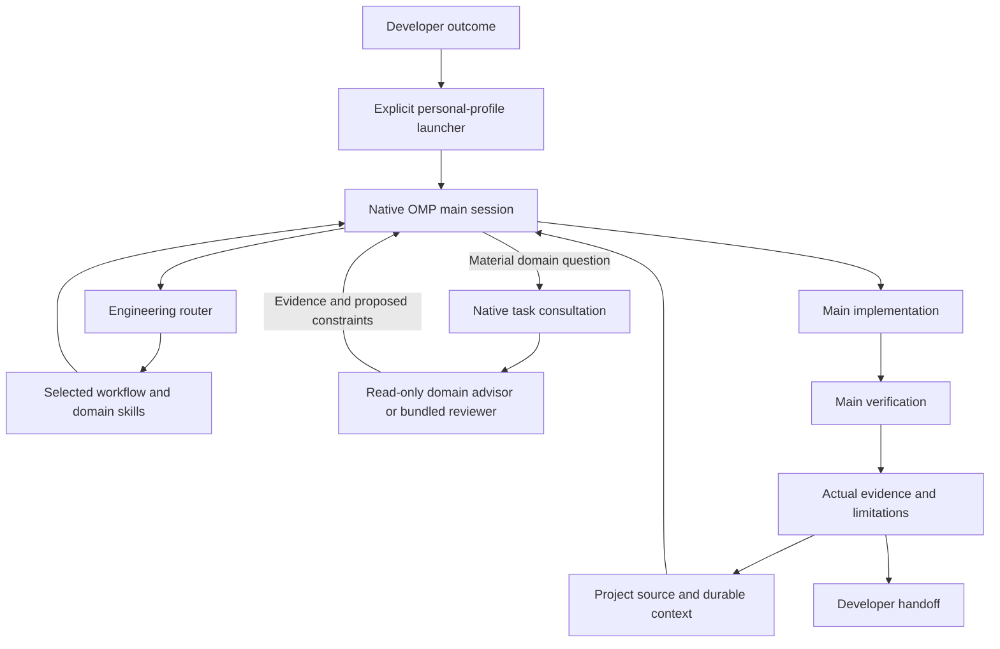

# Architecture

## Scope and authority

This is configuration and procedural knowledge around native OMP, not a new agent runtime. `bin/af` selects the personal profile; OMP performs model/tool execution, sessions, task scheduling, approvals, skill activation, and native browser access. The developer describes outcomes; main chooses a proportional workflow and owns implementation.

Shared safety is authoritative in `profile/RULES.md`. Main-only orchestration is appended by `APPEND_SYSTEM.md`. Workflow ordering and consultation API belong to `af-engineering`; domain procedures belong to focused skills; actual check execution/status belongs to `af-verification`; project records belong to `af-context`; optional checkout lifecycle belongs to `af-isolation`. Pointers disclose relevant material instead of loading every procedure into every task.

## Native configuration boundaries

Activation links config, append text, shared rules, agents, and skills into the native `agent-first` profile. Auth/session/cache state remains in native profile storage, outside source control. The launcher fixes the profile, config overlay, appended contract, write approval and disabled extension discovery; clears inherited directory/session/overlay hints; limits forwarded flags; and refuses known native additive tools or agent shadows. Existing conflicting activation entries are never replaced.

Profiles do not isolate every project/external source. Project instructions remain relevant; the configured foreign discovery and project MCP sources are disabled. Other documented native inheritance and ambient host access still exist. The source checkout must remain at a stable path because activation uses symlinks. Operator settings writes can modify the linked personal config.

No team/default-profile instructions, existing workflow commands, dependency installation, global policy rewrite, external memory database, or production system mutation is part of activation.

## Routing and decision boundaries

The router combines intent, source evidence, complexity, risk and architectural impact. It preserves quick-change, feature-development and architecture-impacting and adds initialization, investigation, refactoring, review and measured optimization. A provisional route changes when evidence changes the required procedure; creating a new design boundary is not hidden inside a quick fix.

Local reversible choices satisfying the authorized outcome proceed without ceremonial approval. Consequential choices need explicit scope and human approval: unrequested breaking contracts, irreversible/data-loss migration, production/external actions, installations, permission changes, and source integration from a checkout. Explain options, impact, rollback and the actual target. Declined/unavailable approval leaves dependent work pending while independent safe work can continue.

Existing explicit denies remain denies even after a chat request. Main offers the reviewed operator action or a separate approved policy decision; it does not use eval, a wrapper command, or a child to evade the deny. This intentionally means some installs/Git publication/OVNFS operations need a human terminal rather than automatic execution.

## Consultation

Six custom domains cover architecture, persistence, trust, UI, performance and operations. Each has concrete inputs, engineering questions, bounds, output constraints and verification recommendations; these are not implementation personas. Native frontmatter restricts built-ins to read/grep/glob, disables spawning, selects medium thinking and autoloads only the relevant domain skill. Shared advice fields distinguish facts, assumptions, recommendations, enforceable constraints and proposed checks.

Main requests only material consultations, supplies the decision question and evidence, evaluates returned advice and resolves/rejects findings with reasons. Native concurrency stays two and recursion one. No nested workers or parallel CLI agents are introduced. Architecture-impacting implementation requires returned architect advice, not a declaration that delegation will happen.

The bundled reviewer is not copied or replaced. Its native metadata is broader than its assigned advisory scope; main supplies actual diff/new-file content so its normal Git procedure is unnecessary. Structured task output retains its native schema. Per-task `tools` forwards eval-defined functions and is not a built-in permission list. Yield-schema failures, timeouts, and attempted forbidden tools remain evidence, not clean completions.

Native children drop main append text and AGENTS.md but inherit RULES.md. Their headless tier handling uses yolo; explicit prompts/denies still fail closed. Tool lists and approvals are not OS containment, and additive capabilities need separate attention.

## Durable state

Repository `.agent-first/` files store minimal authoritative project facts, active requirements/acceptance/plan/progress, decisions, handoff, evidence, issues and corrections. Only relevant artifacts are created. Native sessions store execution history, not the sole decision record.

Recovery reads the context index, active task, relevant accepted decisions and handoff, then reconciles source and instruction conflicts. Accepted constraints need an acceptance source; proposed advice is not accepted policy. Historical PASS entries cannot become current results solely because a new session loads them. Evidence records code state, environment, inputs, actor, exact command/action, status, output and applicability. Updating task/handoff after checks is paperwork, not a new implementation edit invalidating an unchanged tested program.

A correction ledger separates incidents and repeated patterns, diagnosed and hypothesized causes, code/tooling/workflow/skill/architecture placement, actual correction, validation and residual risk. One cascading failure is one occurrence; a targeted parser replay proves parser behavior, not model compliance. Global learning remains off; promotion needs evidence and authority rather than automatic rewriting.

## Verification and optional isolation

Verification uses installed project scripts and real consumer boundaries. Static/types/lint/build, integration/API/database, security, measured performance, operational lifecycle and UI/accessibility checks are selected by affected behavior. PASS/FAIL/NOT-RUN/NOT-APPLICABLE remain distinct. Advisory opinions, source inspection and screenshots cannot substitute for actual runtime behavior.

Tern browser work remains main-only with explicit requested backend, observed actual backend, a task-owned tab/runtime, interaction/keyboard/semantic checks, resulting state/errors and visual evidence. Unsupported/manual/cross-browser coverage is named. No automatic browser downloads or fallback acceptance is authorized.

Native browser documentation says unavailable Tern hosting may fall back to an owned engine. The current procedure checks host availability before opening and actual identity before exercising the page; it does not establish a native fail-closed fallback-disable setting or an unattended no-download guarantee. Keep the normal eval approval boundary and treat this as a limitation rather than inventing configuration.

OVNFS is optional and explicitly selected. Use installed native new/diff/apply-dry-run commands, verify inside the actual printed checkout, review source concurrency/conflicts, and obtain separate integration approval. The normal profile's apply deny is unchanged; operators run reviewed apply commands outside it. Retain a recoverable source baseline, reverify after integration, and clean only owned checkouts. Removing a checkout is not rollback of an applied source change. Copy-on-write filesystem separation does not restrict network, credentials, processes, shared caches or absolute host paths.

## Evaluation contract and limits

The existing sequential evaluation harness remains an evaluation tool, not a runtime for user work. It uses synthetic projects, one selected model, bounded native requests, exact test/diff grants, real task journals and independent consumer checks. Original cases and failure evidence remain. Fresh-session recovery, review-only/no-edit, denied verification and measured performance have distinct contracts. Context bookkeeping is separated from implementation timing. Actual native child IDs, not display names or audit JSONL, establish consultation provenance.

Environment probes do not send model prompts. Browser evaluation uses the actual model-produced UI and native Tern; OVNFS validation uses only disposable repositories and explicit application approval. Read actual advice for design quality: chronology/tool scores cannot grade reasoning. See full validation for executed results and remaining limits. Hostile repositories, OS sandboxing, production deployment, all database dialects, and complete accessibility/security certification are not established by these checks.
