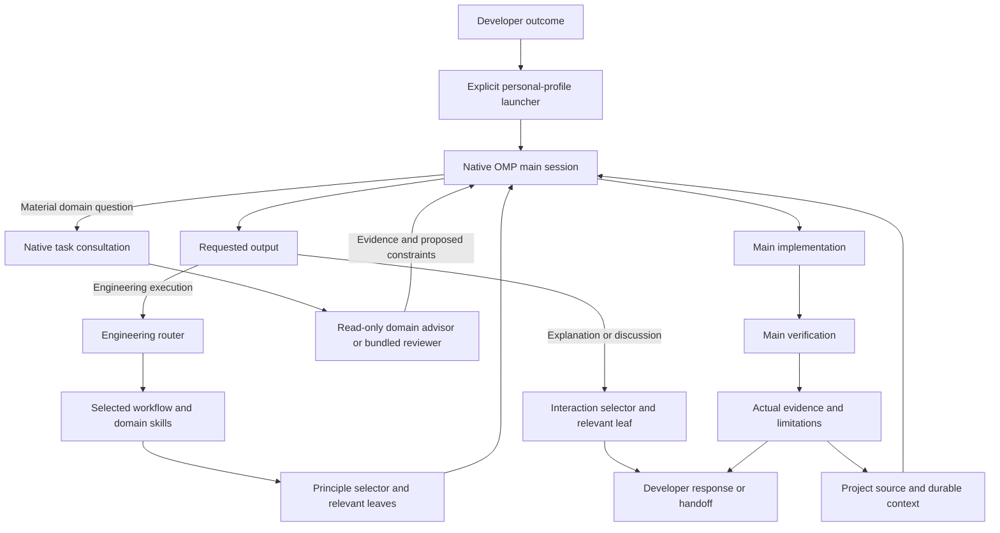

# Architecture

## Scope and authority

This is configuration and procedural knowledge around native OMP, not a new agent runtime. `bin/af` selects the personal profile; OMP performs model/tool execution, sessions, task scheduling, approvals, skill activation, and native browser access. The developer describes outcomes; main chooses a proportional workflow and owns implementation.

Shared safety is authoritative in `profile/RULES.md`. Main-only intent routing is appended by `APPEND_SYSTEM.md`: `af-interaction` owns conversation procedures; `af-engineering` owns engineering workflows and consultation. Domain skills own their procedures; `af-principles` supplies engineering decision criteria; `af-verification` owns check execution/status; `af-context` owns project records; `af-isolation` owns optional checkout lifecycle. The engineering sequence remains workflow -> relevant domain procedure -> relevant principles -> main implementation and checks.

## Interaction & Reasoning intent routing

Explanation, learning, interviews, idea/design discussion, context recovery, reflection and writing requests use `af-interaction` and the relevant full `interaction-*` leaf. Its 20 independent leaves are native procedures, not agents or permission grants. Load one relevant leaf, with a second only for a distinct need; a complex request can sequence phases without eagerly loading the catalog.

Default scope is read-only. Explicit documentation/context/handoff writes authorize only the requested artifacts. Actual diagnosis, defect review, verification and implementation retain their engineering workflows. Mixed requests move to engineering only for an authorized outcome; an ordinary clear change needs no mandatory interview or teaching. Interaction design discussion does not replace the existing architecture-changing consultation requirement.

Both selectors stay visible; `manualSkills: [principle-*, interaction-*]` hides leaf metadata while exact inclusion retains native URI access. Children receive relevant interaction purpose/URI explicitly rather than inheriting main's appended prompt. Existing domain autoload definitions, approvals, specialist boundaries and launcher are unchanged. [Package provenance](../profile/skills/af-interaction/SOURCES.md) is separate from principle attribution.

## Native configuration boundaries

Activation links config, append text, shared rules, agents, and skills into the native `agent-first` profile. Auth/session/cache state remains in native profile storage, outside source control. The launcher fixes the profile, base config overlay, appended contract and disabled extension discovery; clears inherited directory/session/overlay hints; uses a closed forwarded-argument allowlist; and refuses known native additive tools or agent shadows. Arbitrary config, extension and safety overrides are not forwarded. `profile/config.yml`, not a launcher approval-mode flag, is the settings authority and selects native yolo. Existing conflicting activation entries are never replaced. Native `--profile` alone does not provide the launcher's boundary.

One-time `bin/af --setup` installs only the user-local `~/.local/bin/af` symlink plus native profile links, refusing conflicting commands. It does not change shell startup files or implicitly enroll its cwd. Plain `af` uses the current directory; `--cwd` and existing options remain. Fresh launches read the named profile's native default model role, or the ordinary OMP default role if absent, and pass only that selector. No other default-profile settings or credentials are imported; explicit overrides and native saved-model continuation remain available.

Before session activation or model-role lookup, an unknown/changed project needs an operator's explicit personal designation. Interactive confirmation defaults to No; headless launches refuse without enrollment. Private records under `~/.config/agent-first/projects/` bind canonical roots to directory/Git identity and hashed local remote URLs. Git subdirectories share their root record, nested repositories do not, and non-Git folder approval is exact rather than recursive. Git directory/worktree/index redirection hints are cleared. Setup and profile-only activation do not enroll projects or start OMP.

Enrollment is a startup guard, not reliable ownership classification or filesystem/process/network containment. Unchanged metadata can conceal ownership changes; humans must not enroll team/production projects. Existing context and permission boundaries remain authoritative after startup.

Profiles do not isolate every project/external source. Project instructions remain relevant; the configured foreign discovery and project MCP sources are disabled. Other documented native inheritance and ambient host access still exist. The source checkout must remain at a stable path because activation uses symlinks. Operator settings writes can modify the linked personal config.

No team/default-profile instructions, existing workflow commands, dependency installation, global policy rewrite, external memory database, or production system mutation is part of activation.

### Approval controls, not containment

Native yolo auto-approves ordinary read/write/exec tiers for scoped main work, including shell, eval, advisory tasks and Tern browser calls. Explicit prompts survive yolo; deny is absolute and stronger Git guards remain. A generic safety/critical override alone does not force approval in yolo. Headless ASK, including restricted-folder gates, refuses without an interactive approver; leave dependent work pending and continue independent safe work.

`profile/config.yml` is the sole settings authority. AUTO includes routine inspection/content edits and bounded authorized obsolete/generated-file cleanup; checks/debugging/owned services, advisors and Tern; verified project dependency changes/pinned runners, workspace downloads without script execution, ordinary local Docker development without persistent-volume deletion, and normal Git operations subject to guards. Commit/push needs explicit user instruction but no repeated native popup for ordinary requested operations. Main never auto-commits/pushes or proactively asks after each ordinary task.

ASK covers recursive/mass/data-loss deletion; hard Git reset/clean/discard, branch/stash/worktree deletion and history rewrite; global/system tooling/settings, privilege/services, SSH/transfers, cloud/deploy/infrastructure, package/container publication, persistent Docker-volume deletion/prune/cluster or remote-context operations, destructive database utilities and OVNFS integration/discard. Coarse checkout/restore, global installer, remote/cloud, privilege and integration patterns can prompt harmless variants. Native patterns cannot classify production, deletion scope or arbitrary helper effects. Uncertain scope or unmatched high-risk helpers without a reliable native per-operation gate remain operator-only. Existing hard shell/tool denies and semantic prohibitions remain unchanged, including absolute-path rm/chmod/chown denies.

Restricted folders gate path-tool targets including resolved symlinks; shell/eval/browser checks cwd, not embedded paths. Bash uses ordered first-match `*` rules on segments, with deny outranking prompt, not arbitrary-code inspection. Cleanup needs resolved project targets/ancestors, symlinks, ownership and user-change inventory. Ordinary authorized obsolete-file edits/removals or nonrecursive cleanup can be AUTO; recursive/mass/valuable-data deletion is ASK. Native edit has no deletion-only gate: edit REM/eval/scripts cannot replace a gated or refused loss effect. Configuration/credential prohibitions remain behavioral, not general path or network enforcement.

Project dependency install/update/removal is autonomous only within the verified trusted project; pip additionally needs a verified project venv. Inspect lifecycle scripts/bootstrap behavior, exact target and pinned runners: dependencies, tests and builds can execute code or fetch packages with ambient host filesystem, process, credential and network authority. A workspace download does not authorize executing it. Do not automatically install unrelated tooling, global runtimes, analysis backends or browsers. Prefer existing/cached/vendor/offline execution where appropriate and report unavailable verification honestly.

Before effects, verify the exact project/runtime/database/remote and Docker endpoint/context/volumes, not just cwd. Behavioral project scope and production authorization are independent of native pattern matches. Tool grants, restricted-folder prompts and project enrollment provide no OS sandbox or general network containment; optional OVNFS separates checkout files only. This setup is for trusted personal projects, not hostile repositories.

## Routing and decision boundaries

The router combines intent, source evidence, complexity, risk and architectural impact. It preserves quick-change, feature-development and architecture-impacting and adds initialization, investigation, refactoring, review and measured optimization. A provisional route changes when evidence changes the required procedure; creating a new design boundary is not hidden inside a quick fix.

Local reversible choices satisfying the authorized outcome proceed autonomously without ceremonial approval. At consequential boundaries, main explains the short exact command, cwd, resolved target, impact/risk and rollback before submitting the native ASK call. The native display truncates commands and does not infer semantic impact or supply cwd; split and review long consequential commands first. Explicit prompts offer only per-call Approve/Deny, not session approval. Declined/unavailable approval leaves dependent work pending while independent safe work continues.

Existing explicit denies remain denies even after chat approval. Operator fallback is for actual deny/guard or unavailable approval, not the default for supported native prompts. `bash.gitGuard` remains true: branch/stash can refuse shared main checkouts even after approval. Use reviewed operator action or explicitly opted-in private OVNFS where appropriate, never `/usr/bin/git`, wrappers, altered environments, eval, children or policy changes as bypass. Behavioral approval authorizes an outcome, not a policy override.

### Native index-and-leaf loading

The eleven original domain/support skills, two selectors, 24 `principle-*` leaves and 20 `interaction-*` leaves provide **57 exact native registry entries, 13 visible catalog entries**. The [skills catalog](skills-catalog.md) lists pointers. `af-principles` owns engineering judgment triggers and `af-interaction` owns conversational intent; leaf bodies stay independently readable, not appended to main's system prompt.

OMP 18.22.0's `skills.manualSkills: [principle-*, interaction-*]` suppresses leaf catalog metadata while preserving native URI reads. Every exact name remains in `includeSkills`; hiding differs from filtering a skill out. The model reads the relevant selector and directly reads selected full `skill://` leaves before applying them. This index-and-leaf path avoids an eager bundle, new runtime or manual command requirement. Use a fresh session after profile changes; hot-reload is not established.

Usually one to three leaves suffice per decision; trivial understood work normally reads only `prove-it-works`, with at most one other leaf for an actual decision. Reassess when evidence changes, reuse already-read applicable material, and use existing task/decision records only when the choice warrants recording. This is proportional engineering judgment, not a new mandatory ceremony or permission grant. Compatibility, authorization, read-only advice, maximum concurrency two and recursion one remain unchanged.

The selector and leaves adapt [pstack](https://github.com/cursor/plugins/tree/2f87c854fe3e2fcda44ca86b46ede35aad3c46b7/pstack), pinned at `2f87c854fe3e2fcda44ca86b46ede35aad3c46b7`, Copyright (c) 2026 Lauren Tan, MIT. [Sources and adaptation boundaries](../profile/skills/af-principles/SOURCES.md) and the [preserved MIT notice](../profile/skills/af-principles/LICENSE) apply to that material; they do not relicense unrelated project files.

## Consultation

Six custom domains cover architecture, persistence, trust, UI, performance and operations. Each has concrete inputs, engineering questions, bounds, output constraints and verification recommendations; these are not implementation personas. Native frontmatter restricts built-ins to read/grep/glob, disables spawning, selects medium thinking and autoloads the relevant domain skill plus `af-principles`. Shared advice fields distinguish facts, assumptions, recommendations, enforceable constraints and proposed checks.

Main requests only material consultations, supplies the decision question and evidence, evaluates returned advice and resolves/rejects findings with reasons. Native concurrency stays two and recursion one. No nested workers or parallel CLI agents are introduced. Architecture-impacting implementation requires returned architect advice, not a declaration that delegation will happen.

The bundled reviewer is not copied or replaced. Its native metadata is broader than its assigned advisory scope; main supplies actual diff/new-file content so its normal Git procedure is unnecessary. It receives relevant selected leaf URIs, triggers and the review decision explicitly, rather than relying on a custom autoload definition. Structured task output retains its native schema. Per-task `tools` forwards eval-defined functions and is not a built-in permission list. Yield-schema failures, timeouts, and attempted forbidden tools remain evidence, not clean completions.

Native children drop main append text and AGENTS.md but inherit RULES.md and have access to the native skill registry. They do not inherit main's leaf-read history. Main passes only decision-relevant selected leaf URIs, observed triggers, the specific question and adopted constraints; each child reads assigned leaves directly before advice. A new question-relevant trigger can justify an additional child leaf; inaccessible skills remain explicit uncertainty. Their native tier handling uses yolo too; explicit denies still deny and explicit prompts fail closed without an approver. Advisory read-only scope remains binding independently of available tools. Tool lists and approvals are not OS containment, and additive capabilities need separate attention.

## Durable state

Repository `.agent-first/` files store minimal authoritative project facts, active requirements/acceptance/plan/progress, decisions, handoff, evidence, issues and corrections. Only relevant artifacts are created. Native sessions store execution history, not the sole decision record.

Recovery reads the context index, active task, relevant accepted decisions and handoff, then reconciles source and instruction conflicts. Accepted constraints need an acceptance source; proposed advice is not accepted policy. Historical PASS entries cannot become current results solely because a new session loads them. Evidence records code state, environment, inputs, actor, exact command/action, status, output and applicability. Updating task/handoff after checks is paperwork, not a new implementation edit invalidating an unchanged tested program.

A correction ledger separates incidents and repeated patterns, diagnosed and hypothesized causes, code/tooling/workflow/skill/architecture placement, actual correction, validation and residual risk. One cascading failure is one occurrence; a targeted parser replay proves parser behavior, not model compliance. Global learning remains off; promotion needs evidence and authority rather than automatic rewriting.

## Verification and optional isolation

Verification uses scoped project checks and real consumer boundaries. Static/types/lint/build, integration/API/database, security, measured performance, operational lifecycle and UI/accessibility checks are selected by affected behavior. PASS/FAIL/NOT-RUN/NOT-APPLICABLE remain distinct. Advisory opinions, source inspection and screenshots cannot substitute for actual runtime behavior.

Tern browser work remains main-only with preflight of the existing host, explicit requested backend, observed actual backend, a task-owned tab/runtime, interaction/keyboard/semantic checks, resulting state/errors and visual evidence. Ordinary authorized interaction does not require routine approval; consequential external/production UI actions require precise human authorization. Unsupported/manual/cross-browser coverage is named. No automatic browser downloads or fallback acceptance is authorized.

Native browser documentation says unavailable Tern hosting may fall back to an owned engine even with `app: 'tern'`. The procedure checks host availability before opening and actual identity before exercising the page; an unexpected backend is closed and recorded NOT-RUN. This reduces risk but does not establish a native fail-closed fallback-disable setting or an unattended no-download guarantee. The removed routine eval prompt is not a containment boundary or a substitute for host preflight.

OVNFS is optional and explicitly selected. Use installed native new/diff commands, verify inside the printed checkout, and review source concurrency/conflicts. After reviewed diff, obtain native per-call authorization for apply dry-run, then separate authorization for real integration. No automatic isolation/application is enabled. Retain a recoverable source baseline and reverify after integration. Cleanup/discard is consequential ASK, not implied by creation, and applies only to owned checkouts. Operator fallback is only for actual deny/guard or unavailable approval. Removing a checkout is not rollback of applied source changes. Copy-on-write separation does not restrict network, credentials, processes, shared caches or absolute host paths.

## Evaluation contract and limits

The existing sequential evaluation harness remains an evaluation tool, not a runtime for user work. Its restrictive regression overlay uses synthetic projects, one selected model, bounded native requests, exact test/diff grants, real task journals and independent consumer checks; that overlay is deliberately stricter than the operating profile. The original three-case `phase1` and thirteen-case `full` suites remain; `principles` runs all thirteen plus three new cases and principle metadata. Fresh-session recovery, review-only/no-edit, deliberately prompted denied verification and measured performance retain distinct contracts. Context bookkeeping is separated from implementation timing. Actual native child IDs, not display names or audit JSONL, establish consultation provenance.

Principle evidence requires successful full native leaf reads before the relevant decision, explicit child URI handoff and child-read chronology, plus consumer-observable acceptance. Names in prose and catalog visibility are not evidence of application. Negative-selection cases check that trivial work avoids gratuitous exploration, toolmaking and delegation. Bounded manual assessment records the trigger, choice and evidence; chronology alone cannot establish reasoning quality or causal benefit from added prompts. FAIL and NOT-RUN remain visible.

`check_environment.py --baseline PATH` compares effective settings against a captured pre-change baseline, including non-pattern settings, existing deny rules, launcher/default/team assets and user configuration preservation. The controlled-YOLO probe uses the real launcher without an overlay: harmless AUTO help probes cover project installs, requested commit/push, downloads and Docker, separately from headless ASK refusal and hard DENY rejection probes. A missing executable is NOT-RUN runtime coverage, not successful authorization evidence.

`check_ask_policy.py` drives model-native bash through live RPC UI approval state. Exact disposable `rm -r -- approved-empty` and `rm -r -- denied-empty` calls must each trigger `Prompt required by bash pattern: rm *-r*`; Approve removes only the first empty target, Deny preserves the second, and independent safe work continues. Direct user RPC `bash` is operator execution, not an approval test. Commands establish no pass; current observations belong in [Minimal-ASK validation](../eval/minimal-ask-validation.md). [Ask-policy validation](../eval/ask-policy-validation.md) and earlier reports preserve their historical policy scopes and failures.

Interaction regressions use normal profile permissions, full successful native leaf reads, source-grounded answer checks and fixture snapshots that include context files. Requested artifact edits are checked separately from read-only answers; simple implementation and defect review must retain engineering routing. The 23 supplied scenarios are proposed coverage, not executed success. Current package results and review adaptations belong in [Interaction validation](../eval/interaction-validation.md).

Environment probes do not send model prompts. Browser evaluation uses the actual model-produced UI and native Tern; OVNFS validation uses only disposable repositories and explicit application approval. Read actual advice for design quality: chronology/tool scores cannot grade reasoning. New principle-layer observations belong in [Principles validation](../eval/principles-validation.md), with commands and actual limits, not an assumed all-model pass. [Controlled YOLO validation](../eval/controlled-yolo-validation.md), [Full validation](../eval/full-validation.md) and [Phase 1 validation](../eval/validation.md) remain historical with their original scopes and failures. Hostile repositories, OS sandboxing, production deployment, all database dialects, complete accessibility/security certification, broader native versions/environments and unknown-skill failure handling are not established by these checks.
