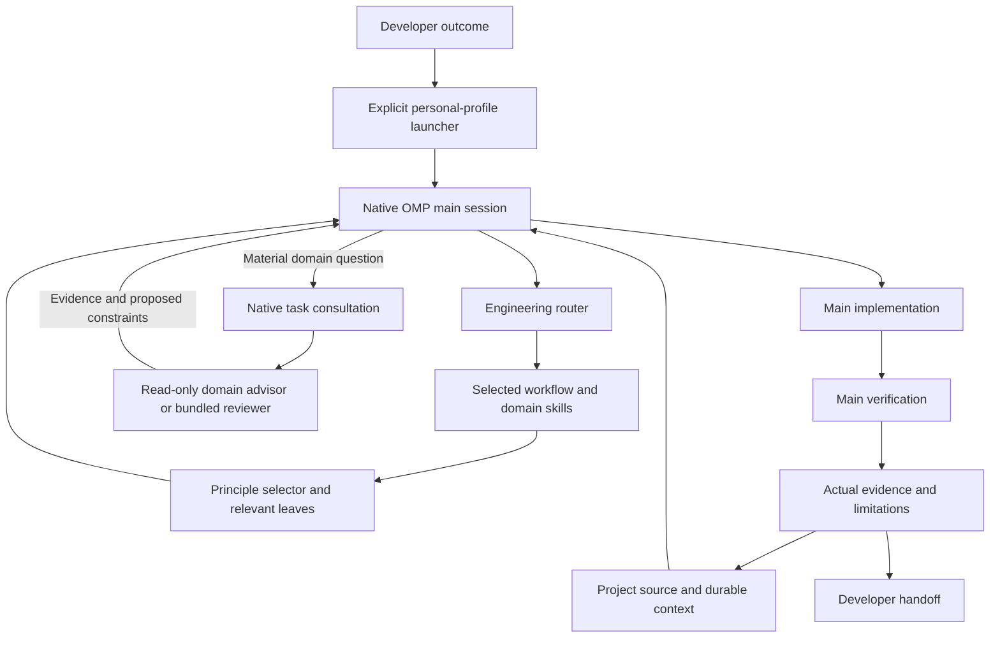

# Architecture

## Scope and authority

This is configuration and procedural knowledge around native OMP, not a new agent runtime. `bin/af` selects the personal profile; OMP performs model/tool execution, sessions, task scheduling, approvals, skill activation, and native browser access. The developer describes outcomes; main chooses a proportional workflow and owns implementation.

Shared safety is authoritative in `profile/RULES.md`. Main-only orchestration is appended by `APPEND_SYSTEM.md`. Workflow ordering and consultation API belong to `af-engineering`; domain procedures belong to focused skills; `af-principles` supplies decision criteria, not a replacement procedure; actual check execution/status belongs to `af-verification`; project records belong to `af-context`; optional checkout lifecycle belongs to `af-isolation`. The sequence is workflow -> relevant domain procedure -> relevant principles -> main implementation and checks.

## Native configuration boundaries

Activation links config, append text, shared rules, agents, and skills into the native `agent-first` profile. Auth/session/cache state remains in native profile storage, outside source control. The launcher fixes the profile, base config overlay, appended contract and disabled extension discovery; clears inherited directory/session/overlay hints; uses a closed forwarded-argument allowlist; and refuses known native additive tools or agent shadows. Arbitrary config, extension and safety overrides are not forwarded. `profile/config.yml`, not a launcher approval-mode flag, is the settings authority and selects native yolo. Existing conflicting activation entries are never replaced. Native `--profile` alone does not provide the launcher's boundary.

One-time `bin/af --setup` installs only the user-local `~/.local/bin/af` symlink plus native profile links, refusing conflicting commands. It does not change shell startup files or implicitly enroll its cwd. Plain `af` uses the current directory; `--cwd` and existing options remain. Fresh launches read the named profile's native default model role, or the ordinary OMP default role if absent, and pass only that selector. No other default-profile settings or credentials are imported; explicit overrides and native saved-model continuation remain available.

Before session activation or model-role lookup, an unknown/changed project needs an operator's explicit personal designation. Interactive confirmation defaults to No; headless launches refuse without enrollment. Private records under `~/.config/agent-first/projects/` bind canonical roots to directory/Git identity and hashed local remote URLs. Git subdirectories share their root record, nested repositories do not, and non-Git folder approval is exact rather than recursive. Git directory/worktree/index redirection hints are cleared. Setup and profile-only activation do not enroll projects or start OMP.

Enrollment is a startup guard, not reliable ownership classification or filesystem/process/network containment. Unchanged metadata can conceal ownership changes; humans must not enroll team/production projects. Existing context and permission boundaries remain authoritative after startup.

Profiles do not isolate every project/external source. Project instructions remain relevant; the configured foreign discovery and project MCP sources are disabled. Other documented native inheritance and ambient host access still exist. The source checkout must remain at a stable path because activation uses symlinks. Operator settings writes can modify the linked personal config.

No team/default-profile instructions, existing workflow commands, dependency installation, global policy rewrite, external memory database, or production system mutation is part of activation.

### Approval controls, not containment

Native yolo auto-approves ordinary read/write/exec tiers for scoped main work, including shell, eval, advisory tasks and Tern browser calls. Explicit tool/pattern prompts and denies still apply in every mode; deny is absolute. A generic safety/critical override alone does not force approval in yolo. Headless ordinary execution can proceed, but residual native prompts, including restricted-folder gates, explicit stricter overlays or provider safety, refuse without an interactive approver.

Restricted folders gate path-tool targets including resolved symlinks; shell/eval/browser checks use cwd, not file paths embedded in commands or code. Bash patterns are ordered command matching with `*` wildcards, not inspection of arbitrary eval, project-script or subprocess behavior. `profile/config.yml` owns the actual deny families and restricted directories; shared rules own point-of-risk human authorization and prohibit bypass.

Shell, eval and browser runtimes retain ambient host filesystem, process, credential and network access. Inspect trusted scripts and their bootstrap behavior before execution: tests/builds can fetch packages themselves, including Go/Cargo dependency resolution. Use installed/cached/vendor/offline execution where appropriate and stop for missing dependencies; a script is not installation authorization. Command patterns do not enforce these internal filesystem/network restrictions. Restricted-folder prompts and behavioral instructions are also distinct from OS isolation: none provides a sandbox or general network containment, and optional OVNFS only separates checkout files. This setup is for trusted personal projects.

## Routing and decision boundaries

The router combines intent, source evidence, complexity, risk and architectural impact. It preserves quick-change, feature-development and architecture-impacting and adds initialization, investigation, refactoring, review and measured optimization. A provisional route changes when evidence changes the required procedure; creating a new design boundary is not hidden inside a quick fix.

Local reversible choices satisfying the authorized outcome proceed autonomously without ceremonial approval. At the point of risk, consequential choices outside that authorization need explicit scope and human approval: unrequested breaking contracts, irreversible/data-loss migration, production/external actions, installations, permission changes, and source integration from a checkout. Explain options, impact, rollback and the actual target. Declined/unavailable approval leaves dependent work pending while independent safe work can continue.

Existing explicit denies remain denies even after chat approval. Main presents the reviewed operator-terminal action; it does not use eval, a wrapper command, subprocess, child, or policy change to evade the deny. Coarsely denied command families remain operator-only even when a particular invocation appears harmless. Behavioral approval authorizes an outcome, not a permission-policy override.

### Native index-and-leaf loading

The eleven original domain/support skills remain intact. `af-principles` adds one selector and 24 independent `principle-*` leaves: **36 exact native registry entries, 12 visible catalog entries**. The [skills catalog](skills-catalog.md) lists names, purposes and pointers; the [selector](../profile/skills/af-principles/SKILL.md) is the authoritative trigger/workflow/domain activation map. Each leaf holds its own operational guidance rather than a title or an alias into one large document.

OMP 18.22.0's `skills.manualSkills: [principle-*]` suppresses leaf catalog metadata while preserving native URI reads. `includeSkills` must include every exact name; hiding an included leaf is different from filtering it out. The model discovers the selector, matches observed decision triggers, then uses direct native `read` on the relevant `skill://principle-*` URIs in full before applying them. Leaf bodies are not appended to the main prompt. This index-and-leaf path limits always-loaded context without adding a runtime, manual commands or an eager all-leaf bundle. Use a fresh session after profile changes; hot-reload is not established.

Usually one to three leaves suffice per decision; trivial understood work normally reads only `prove-it-works`, with at most one other leaf for an actual decision. Reassess when evidence changes, reuse already-read applicable material, and use existing task/decision records only when the choice warrants recording. This is proportional engineering judgment, not a new mandatory ceremony or permission grant. Compatibility, authorization, read-only advice, maximum concurrency two and recursion one remain unchanged.

The selector and leaves adapt [pstack](https://github.com/cursor/plugins/tree/2f87c854fe3e2fcda44ca86b46ede35aad3c46b7/pstack), pinned at `2f87c854fe3e2fcda44ca86b46ede35aad3c46b7`, Copyright (c) 2026 Lauren Tan, MIT. [Sources and adaptation boundaries](../profile/skills/af-principles/SOURCES.md) and the [preserved MIT notice](../profile/skills/af-principles/LICENSE) apply to that material; they do not relicense unrelated project files.

## Consultation

Six custom domains cover architecture, persistence, trust, UI, performance and operations. Each has concrete inputs, engineering questions, bounds, output constraints and verification recommendations; these are not implementation personas. Native frontmatter restricts built-ins to read/grep/glob, disables spawning, selects medium thinking and autoloads the relevant domain skill plus `af-principles`. Shared advice fields distinguish facts, assumptions, recommendations, enforceable constraints and proposed checks.

Main requests only material consultations, supplies the decision question and evidence, evaluates returned advice and resolves/rejects findings with reasons. Native concurrency stays two and recursion one. No nested workers or parallel CLI agents are introduced. Architecture-impacting implementation requires returned architect advice, not a declaration that delegation will happen.

The bundled reviewer is not copied or replaced. Its native metadata is broader than its assigned advisory scope; main supplies actual diff/new-file content so its normal Git procedure is unnecessary. It receives relevant selected leaf URIs, triggers and the review decision explicitly, rather than relying on a custom autoload definition. Structured task output retains its native schema. Per-task `tools` forwards eval-defined functions and is not a built-in permission list. Yield-schema failures, timeouts, and attempted forbidden tools remain evidence, not clean completions.

Native children drop main append text and AGENTS.md but inherit RULES.md and have access to the native skill registry. They do not inherit main's leaf-read history. Main passes only decision-relevant selected leaf URIs, observed triggers, the specific question and adopted constraints; each child reads assigned leaves directly before advice. A new question-relevant trigger can justify an additional child leaf; inaccessible skills remain explicit uncertainty. Their native tier handling uses yolo too; explicit denies still deny and explicit prompts fail closed without an approver. Advisory read-only scope remains binding independently of available tools. Tool lists and approvals are not OS containment, and additive capabilities need separate attention.

## Durable state

Repository `.agent-first/` files store minimal authoritative project facts, active requirements/acceptance/plan/progress, decisions, handoff, evidence, issues and corrections. Only relevant artifacts are created. Native sessions store execution history, not the sole decision record.

Recovery reads the context index, active task, relevant accepted decisions and handoff, then reconciles source and instruction conflicts. Accepted constraints need an acceptance source; proposed advice is not accepted policy. Historical PASS entries cannot become current results solely because a new session loads them. Evidence records code state, environment, inputs, actor, exact command/action, status, output and applicability. Updating task/handoff after checks is paperwork, not a new implementation edit invalidating an unchanged tested program.

A correction ledger separates incidents and repeated patterns, diagnosed and hypothesized causes, code/tooling/workflow/skill/architecture placement, actual correction, validation and residual risk. One cascading failure is one occurrence; a targeted parser replay proves parser behavior, not model compliance. Global learning remains off; promotion needs evidence and authority rather than automatic rewriting.

## Verification and optional isolation

Verification uses installed project scripts and real consumer boundaries. Static/types/lint/build, integration/API/database, security, measured performance, operational lifecycle and UI/accessibility checks are selected by affected behavior. PASS/FAIL/NOT-RUN/NOT-APPLICABLE remain distinct. Advisory opinions, source inspection and screenshots cannot substitute for actual runtime behavior.

Tern browser work remains main-only with preflight of the existing host, explicit requested backend, observed actual backend, a task-owned tab/runtime, interaction/keyboard/semantic checks, resulting state/errors and visual evidence. Ordinary authorized interaction does not require routine approval; consequential external/production UI actions require precise human authorization. Unsupported/manual/cross-browser coverage is named. No automatic browser downloads or fallback acceptance is authorized.

Native browser documentation says unavailable Tern hosting may fall back to an owned engine even with `app: 'tern'`. The procedure checks host availability before opening and actual identity before exercising the page; an unexpected backend is closed and recorded NOT-RUN. This reduces risk but does not establish a native fail-closed fallback-disable setting or an unattended no-download guarantee. The removed routine eval prompt is not a containment boundary or a substitute for host preflight.

OVNFS is optional and explicitly selected. Use installed native new/diff/apply-dry-run commands, verify inside the actual printed checkout, review source concurrency/conflicts, and obtain separate integration approval. The normal profile's apply deny is unchanged; operators run reviewed apply commands outside it. Retain a recoverable source baseline, reverify after integration, and clean only owned checkouts. Removing a checkout is not rollback of an applied source change. Copy-on-write filesystem separation does not restrict network, credentials, processes, shared caches or absolute host paths.

## Evaluation contract and limits

The existing sequential evaluation harness remains an evaluation tool, not a runtime for user work. Its restrictive regression overlay uses synthetic projects, one selected model, bounded native requests, exact test/diff grants, real task journals and independent consumer checks; that overlay is deliberately stricter than the operating profile. The original three-case `phase1` and thirteen-case `full` suites remain; `principles` runs all thirteen plus three new cases and principle metadata. Fresh-session recovery, review-only/no-edit, deliberately prompted denied verification and measured performance retain distinct contracts. Context bookkeeping is separated from implementation timing. Actual native child IDs, not display names or audit JSONL, establish consultation provenance.

Principle evidence requires successful full native leaf reads before the relevant decision, explicit child URI handoff and child-read chronology, plus consumer-observable acceptance. Names in prose and catalog visibility are not evidence of application. Negative-selection cases check that trivial work avoids gratuitous exploration, toolmaking and delegation. Bounded manual assessment records the trigger, choice and evidence; chronology alone cannot establish reasoning quality or causal benefit from added prompts. FAIL and NOT-RUN remain visible.

Environment probes do not send model prompts. Browser evaluation uses the actual model-produced UI and native Tern; OVNFS validation uses only disposable repositories and explicit application approval. Read actual advice for design quality: chronology/tool scores cannot grade reasoning. New principle-layer observations belong in [Principles validation](../eval/principles-validation.md), with commands and actual limits, not an assumed all-model pass. Current-policy probes retain their exact scope in [Controlled YOLO validation](../eval/controlled-yolo-validation.md). [Full validation](../eval/full-validation.md) and [Phase 1 validation](../eval/validation.md) remain historical. Hostile repositories, OS sandboxing, production deployment, all database dialects, complete accessibility/security certification, broader native versions/environments and unknown-skill failure handling are not established by these checks.
