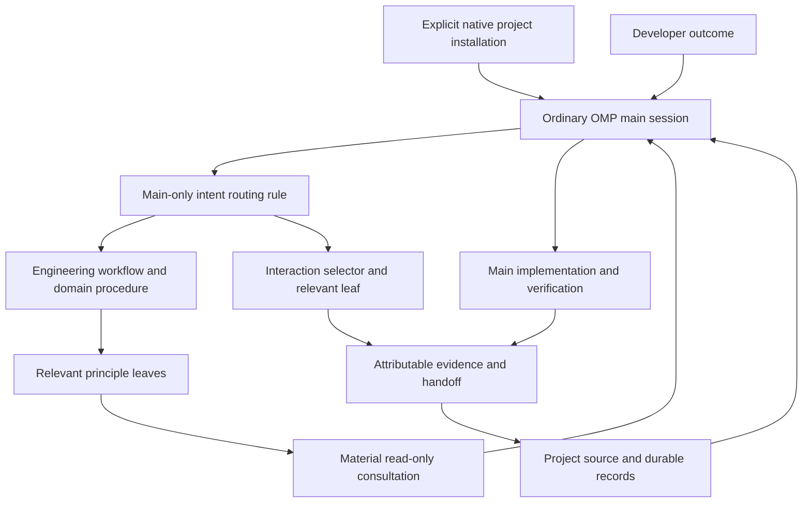

# Architecture

## Native package, not a runtime

Agent-First 2.0.0 targets OMP 18.22.1 using only the project-scoped marketplace plugin `agent-first@agent-first`. Source repository: `alduraimron/agent-first`. The catalog `.omp-plugin/marketplace.json` points to `./plugins/agent-first`; plugin metadata lives in that directory's `.omp-plugin/plugin.json`. Conventional `skills/`, `agents/` and `rules/` are native marketplace discovery surfaces. No portable-schema root `plugin.json`, executable extension, hooks, custom tools, package dependencies or second orchestrator are required.

OMP owns discovery, model execution, task scheduling, native approval/guards, sessions and browser APIs. The plugin supplies behavioral contracts and knowledge. It does not set permissions, model roles, provider configuration, extension discovery, browser backends or scheduling settings.

## Scope and lifecycle

Project install requires `--scope project`; the manifest cannot enforce it and native default scope is user. The anchor is the nearest ancestor `.omp/`, otherwise nearest Git root; absent both, explicit installation can create `.omp/` in cwd (not home). All descendants of the anchor see that install. A high-level `.omp/` is therefore a potentially broader boundary than a Git repository.

`<anchor>/.omp/plugins/` stores project registration/enable state. Native user storage holds marketplace registry and shared version-keyed caches, not an Agent-First permission policy. Same-version reinstall can replace content used by other projects/scopes; publish a new immutable version for updates. Scope selects registration, not a private cache. No `AGENTS.md` or settings file is silently overwritten. Installation is not enrollment, ownership detection, trust proof or a sandbox.

The [usage guide](../README.md) separates local-checkout testing from future GitHub publication. Native catalog refresh and installed-plugin upgrade are separate operations. Restart after CLI mutations; in TUI `/reload-plugins` refreshes supported skills/agents/commands/MCP capabilities after marketplace changes, while a restart gives a complete rule/context rebuild. Other plugins' new non-MCP tools, hooks and modules require restart. ACP/RPC refresh semantics are narrower and differ from TUI.

Real old launcher/profile symlinks remain untouched. Optional operator cleanup requires checking each old target individually; native uninstall is not legacy-state deletion.

## Rule ownership and inheritance

`rules/agent-first-orchestrator.md` has `alwaysApply: true` and `agents: [main]`. It owns main-only intent routing, workflow selection and implementation ownership; advisors must not become orchestrators.

`rules/agent-first-shared.md` has `alwaysApply: true` and explicitly targets main, all six `af-*` advisors and bundled `reviewer`. It owns scoped authorization, read-only advisory behavior, evidence/handoff and shared boundaries. Procedures reference `rule://agent-first-shared`, not a linked profile `RULES.md`.

Marketplace rules are implemented by OMP v18.22.1 `packages/coding-agent/src/discovery/claude-plugins.ts` **`loadRules`**, even where marketplace summaries omit rules. Rule agent filters provide the main/shared split without appending a launcher system prompt. Native context and task inheritance still apply: children do not inherit main's read history or main-only contract; explicit scoped leaf handoffs remain necessary. Provider/rule disables are honored, never repaired by silently editing operator configuration.

## Discovery and coexistence

Native [skills documentation](omp://skills.md) and [task discovery documentation](omp://task-agent-discovery.md) are authoritative for precedence:

- Skills use provider priority, with native/custom overrides able to keep the bare name. Identical copies collapse; differing copies receive namespaced aliases and warnings. A bare URI is not proof that this plugin's body won.
- Agents use exact-name, first-wins deduplication: nearest project `.omp/agents`, user native agents, extension roots, marketplace roots (project before user), then bundled agents. A project/user definition can shadow `af-architect` or `reviewer`; the plugin neither deletes nor overwrites it.
- Native `claude-plugins` provider gating applies to this conventional marketplace surface. OMP-owned installs do not require opting into foreign Claude user registries, but an explicit provider disable still wins.
- Plugin disable/feature selection, `skills.enabled`, include/ignore filters, per-skill disables, rule controls and `task.disabledAgents` remain operator authority. Never enable them behind the operator's back.

Check resolved source and behavior when a required skill/agent/rule is missing or shadowed. Native collision behavior is coexistence, not a guarantee every advisor is available or hard-restricted.

## Routing and proportional loading

Eight engineering workflows remain: project-initialization, feature-development, bug-investigation, refactoring, architecture-impacting, code-review, performance-optimization and quick-change. Main announces the selected route with its reason and revises it when evidence changes. The sequence is workflow -> relevant domain procedure -> relevant principles -> main implementation and checks. Architecture-impacting implementation requires returned architect advice first; local understood edits do not delegate.

Explanation, learning, interviews, idea/design discussion, context recovery, reflection and writing use `af-interaction` and the relevant full leaf. Read-only is default; explicitly requested artifact writes authorize only those artifacts. Actual diagnosis, review, verification and implementation use engineering routes. Clear changes need no compulsory interview. Interaction architecture discussion is not implementation consultation.

The catalog contains eleven original domain/support skills, two selectors, 24 principle leaves and 20 interaction leaves: **57 registered skills, 13 visible entries, 44 hidden-but-readable leaves** in an unfiltered, non-colliding installation. Leaves carry `hide: true`, not removal or an installed `manualSkills` setting. [Native skills semantics](omp://skills.md) retain `skill://` and optional skill-command access when hidden. Operator filters can still remove them.

Selectors choose relevant full bodies rather than eagerly appending all leaves. Usually one to three principles inform a decision; trivial understood work normally needs proof and at most one additional justified leaf. A catalog entry, name mention or late read does not prove application. See the [catalog](skills-catalog.md) for every name and attribution.

## Read-only consultation

Six advisors cover architecture, database, security, frontend, performance and operations. Their definitions declare read/grep/glob, `spawns: []`, domain/selector autoload, `structured: true` and a native output schema with required string `report`. The schema supplies native yield independently of global `task.structured`; the boolean alone with no schema does not. Declared built-ins do not block additive MCP/extension capabilities. Advisory scope remains binding but is not OS containment.

Main passes the concrete question, relevant evidence, selected leaf URIs/triggers and adopted constraints. Children read assigned leaves themselves and distinguish facts, assumptions, recommendations and checks. Main evaluates advice and owns implementation/verification. Two concurrent consultations and one delegation level are instructions, not configuration overrides or an assertion about inherited scheduler limits.

The native bundled `reviewer` is reused without a cloned agent definition. Provide literal diff/new-file content, relevant principle handoff and an explicit read-only assignment. Its native tools are broader than advisory scope; inspect actual calls. In OMP 18.22.1 it declares a schema without `structured: true`: use schema-preserving yields only when native task settings supply `yield`, otherwise use its inspected final findings/verdict. Do not install `task.structured` to force a mode. Invalid tool/schema results, forbidden attempts, errors and timeouts remain failures even if another call later succeeds.

## Authorization without a custom policy

No approval-mode, command-pattern matrix, model/config overlay or tool/provider policy ships in the plugin. Native operator/project settings and guards continue unchanged. Behavioral authorization is independently scoped to the requested outcome, exact target and risk. Refused or unavailable approval leaves dependent work pending; continue independent safe work without wrappers, altered environments, children or another tool as a bypass. Commit/push requires explicit user instruction.

Resolve project, runtime, database, Docker context/volumes, remote target, ownership and user changes before consequential effects. Dependencies/tests/builds can execute code with ambient host authority; downloads do not authorize script execution. Do not provision unrelated global tools, runtimes, backends or browsers automatically. Native grants and advisory rules are not a filesystem/network/credential sandbox.

## Durable project state

`af-context` preserves ordinary `.agent-first/` context, task, decision, verification, handoff, issue and correction templates. Create only meaningful records. Accepted decisions require an acceptance source; advice is not automatically policy. Native sessions preserve execution detail, not the sole durable decision record.

Project standards are separate from task memory. The architecture interaction records approved conventions or designs only when the operator authorizes saving them. Project instructions link directly to scoped guides and architecture docs; engineering work reads the matching guidance before editing.

Recovery reads active context/task, relevant accepted decisions and handoff, then reconciles changed source and instructions. Evidence records state, environment, inputs, actor, actual command/action and applicability. Historical PASS cannot become current evidence merely by loading it. Context bookkeeping after checks does not invalidate unchanged tested implementation.

Correction records separate observed incidents, repeated patterns, diagnosed versus hypothesized causes, actual changes, owning layer, validation and residual risk. One cascading incident is not repeated evidence; parser replay is not fresh model compliance. There is no automatic global learning or configuration rewrite.

## Verification, Tern and OVNFS

Select relevant existing checks and real consumer boundaries; report PASS/FAIL/NOT-RUN/NOT-APPLICABLE separately. Opinions, source inspection and screenshots cannot replace runtime behavior. Record denied/unavailable checks honestly.

Browser work stays main-owned, using existing Tern hosting/native APIs. Preflight host availability, observe backend identity, use task-owned resources and real UI/keyboard/semantic interaction, inspect errors and capture visual proof. Native own-engine fallback may occur even when Tern is requested; unexpected backend means NOT-RUN for Tern coverage, not automatic installation or fallback acceptance. Full accessibility/manual assistive technology and cross-browser support remain explicit gaps.

OVNFS is explicit opt-in, never automatic isolation/apply. Use native new/diff, verify within the printed checkout, review exact diff/source concurrency and preserve a recoverable baseline. Dry-run, actual source integration and owned-checkout discard require separate scope/authorization plus native gates when configured. Reverify after apply. Removing a checkout does not roll back applied source. Copy-on-write file separation does not contain network, credentials, processes, caches or absolute host paths.

## Evaluation and evidence limits

The [evaluation harness](../eval/README.md) is not a runtime. `check_plugin.py` exercises isolated local native marketplace lifecycle, project boundaries, discovery and preservation; `check_principles.py` and `check_interactions.py` retain loading/behavior checks. `run.py --policy native` preserves inherited permissions while explicit evaluation controls handle deterministic scheduling/budgets; `--policy strict` adds synthetic restrictive regression controls. Forced-prompt cases are independently explicit fixtures, never shipped plugin policy.

Keep original suites/consumer assertions, task-ID provenance, actual full-leaf reads and chronology, read-only/no-edit contracts, executed FAIL and approval-specific NOT-RUN, measurements and UI gaps. Preserve failed journals/results and historical reports unchanged. Old launcher/custom-policy validation is historical only. Current observed results and integration corrections are in the [migration validation report](../eval/plugin-migration-validation.md), including model compliance failures; packaging success is not a blanket workflow pass.

Native references: [marketplace](omp://marketplace.md), [task discovery](omp://task-agent-discovery.md), [skills](omp://skills.md), and [versioned marketplace rule loading](https://github.com/can1357/oh-my-pi/blob/v18.22.1/packages/coding-agent/src/discovery/claude-plugins.ts). The validation report links the complete versioned evidence. Broader versions, all-model reliability, hostile repositories, OS sandboxing, production readiness, all database dialects and complete accessibility are not established by a local pass.
